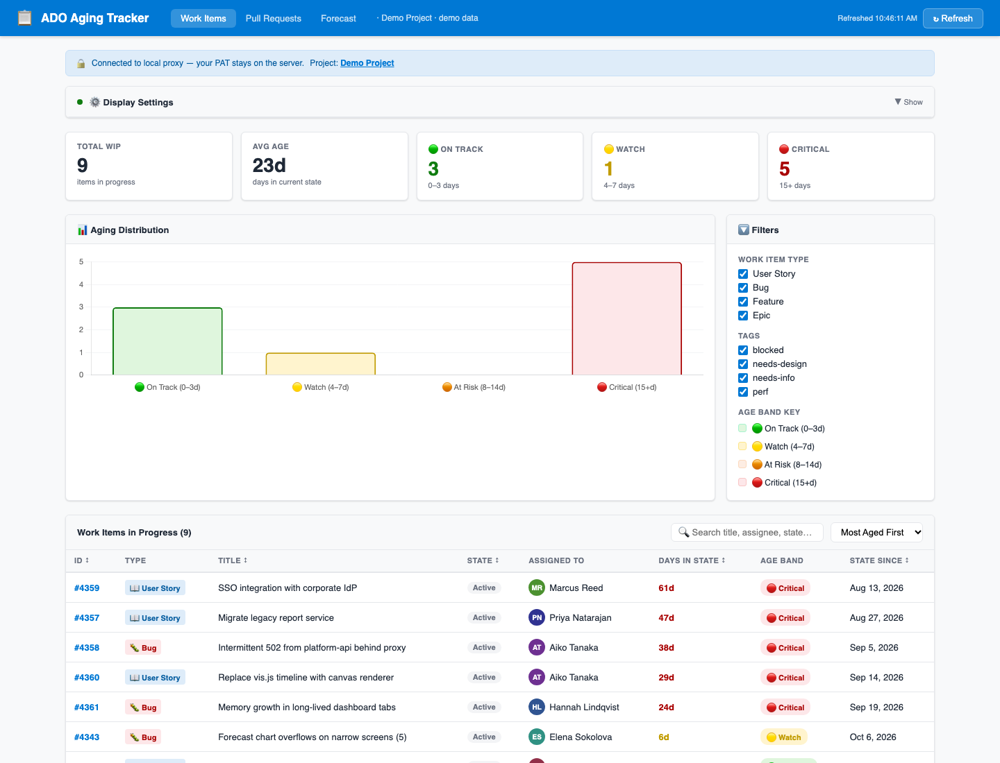
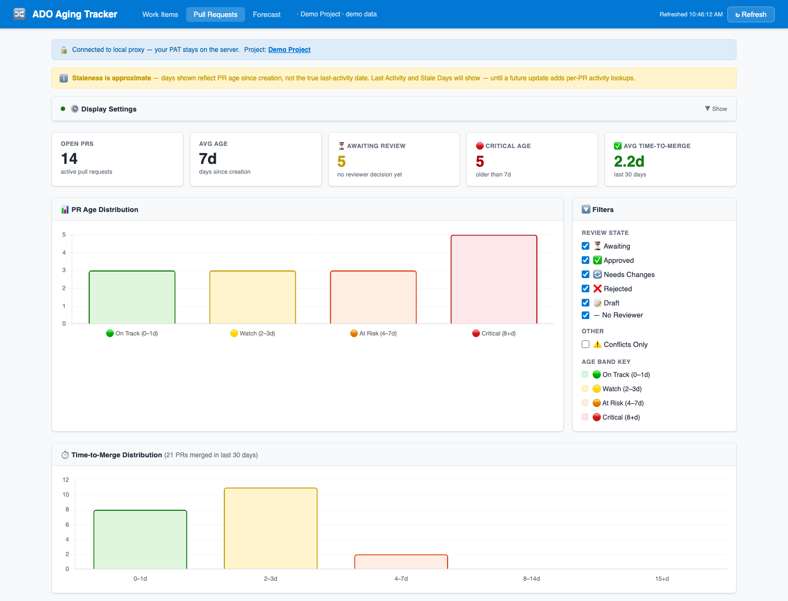
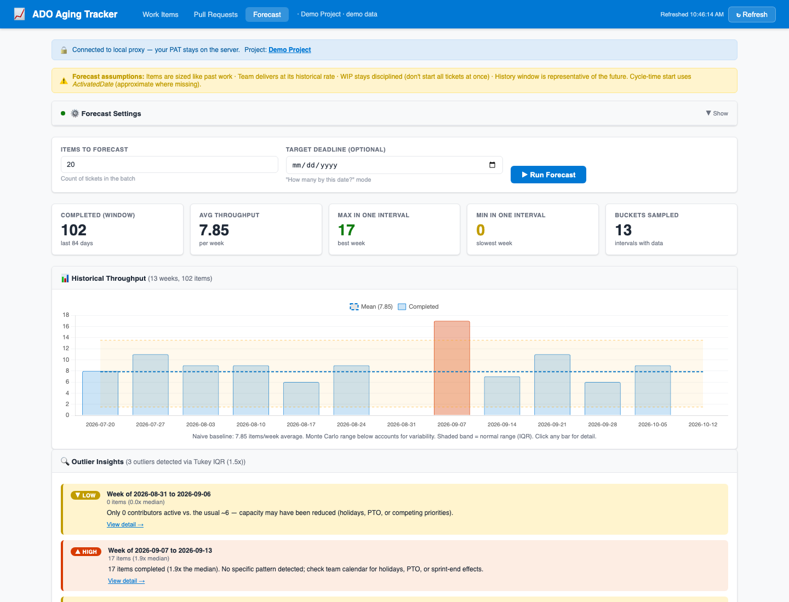

# ado-flow-metrics

**Flow metrics for Azure DevOps teams — WIP aging, PR aging, throughput, cycle time, and Monte Carlo delivery forecasting — in one small local app.** Your PAT never leaves the server process.

[](https://github.com/jacobv25/ado-flow-metrics/actions/workflows/ci.yml)
[](LICENSE)


| Work items | Pull requests | Forecast |
|---|---|---|
|  |  |  |

*Screenshots are from demo mode — a fictional 8-person team with synthetic, seeded data.*

## Why this exists

Azure DevOps boards show you **status**. They don't show you **age** — how long a story has sat in "Active," how long a pull request has waited for a reviewer, or how many items the team actually finishes in a normal week. I built this for my own team (20 engineers, one ADO project, no flow visibility) to answer four questions during planning and stand-up:

1. **What's stuck?** Which work items have been in progress longer than our policy allows?
2. **What's waiting on review?** Which PRs are aging, stale, or sitting with reviewers who haven't voted?
3. **How fast do we really deliver?** Weekly throughput and cycle-time percentiles (p50 / p85 / p95), and *why* an unusual week was unusual.
4. **When will this batch be done?** A probabilistic forecast — "20 tickets: 85% confident by Nov 9" — from historical throughput, with no per-ticket estimation.

The WIP-aging and PR-aging policies this tool made visible are the ones my team adopted. The open-source version ships with a **demo mode** so you can run every view without an Azure DevOps account.

## Quick start (demo mode, no Azure DevOps needed)

```sh
git clone https://github.com/jacobv25/ado-flow-metrics.git
cd ado-flow-metrics
npm install
npm run demo          # DEMO_MODE=true — synthetic data, zero network calls
open http://localhost:3333
```

Demo mode swaps the Azure DevOps HTTP client for [`lib/demoAdo.js`](lib/demoAdo.js), a deterministic fake that answers the same three REST endpoints (`wit/wiql`, `wit/workitemsbatch`, `git/pullrequests`). **Every route in `server.js` runs unchanged** — only the transport differs — so what you see is what a live org would show.

## Connect to your organization

```sh
cp .env.example .env     # then fill in ADO_ORG, ADO_PROJECT, ADO_PAT
npm start
```

Your PAT needs **Work Items (Read)** and **Code (Read)** scopes. See [`.env.example`](.env.example) for on-prem Azure DevOps Server and corporate-CA options.

**Security model:** the browser only ever talks to `localhost`. The PAT is read once from the environment and used by a single `adoRequest()` helper; it is never sent to the page, logged, or written to disk. All query inputs (states, types, day windows) are validated against allowlists before they reach a WIQL query.

## What each view shows

**Work Items** — every item in a WIP state (configurable: `Active`, `In Progress`, `Committed`, …), its days-in-state, and an age band (On Track / Watch / At Risk / Critical with thresholds you set). Summary cards, an aging-distribution chart, filters by type and tag, search, sort, pagination. Thresholds and filters persist in `localStorage`.

**Pull Requests** — open PRs with age, derived review state (`awaiting`, `approved`, `changes`, `rejected`, `draft`, `none` — computed from reviewer votes and required-reviewer rules), merge-conflict flag, and reviewer avatars. Plus a time-to-merge distribution and average over the last 7 / 14 / 30 / 90 days.

**Forecast** — weekly throughput over a 28–180 day window with mean and IQR band, cycle-time percentiles, and two Monte Carlo questions: *how long for N items?* (p50 / p70 / p85 / p95 dates) and *how many by a date?* The **Outlier Insights** panel flags unusual weeks (Tukey IQR fence, MAD fallback for small samples) and explains each one from the items in that bucket: type mix, size mix, contributor count, batch-close clusters, aged-WIP flushes.

## How the forecast works

Instead of sizing tickets, the forecast samples the team's own history. Each trial draws random past weeks (with replacement) and accumulates completed items until the batch is done; thousands of trials give a distribution of finish weeks, read off at the 50/70/85/95th percentiles. The math lives in [`lib/montecarlo.js`](lib/montecarlo.js) — pure, dependency-free, seedable, and shared verbatim between Node and the browser. Assumptions are stated on the page itself (items are sized like past work, WIP stays disciplined, the window is representative).

Outlier detection and attribution are in [`lib/outliers.js`](lib/outliers.js), same shape: pure functions, UMD, tested. The labels are heuristics, not certainties — the tool says so, because it can't see holidays or PTO.

## Architecture

```
server.js              Express proxy. Env validation, input allowlists, 6 JSON routes.
lib/adoClient.js       The only place HTTPS calls happen. PAT stays here.
lib/demoAdo.js         Fake ADO for DEMO_MODE: seeded synthetic team, same endpoints.
lib/montecarlo.js      Forecasting (pure, UMD, seedable).
lib/outliers.js        Outlier detection + attribution (pure, UMD).
public/                Three hand-written pages + shared common.js/styles.css. Chart.js via SRI-pinned CDN.
tests/                 Node assert-based tests (no framework).
docs/plans/            The design docs each feature was built from (see below).
```

Two dependencies at runtime: `express` and `dotenv`.

## Design docs

Each feature beyond the original WIP view started as a written plan — options, trade-offs, a recommendation, and a phased roadmap — before any code:

- [`docs/plans/PR-AGING-PLAN.md`](docs/plans/PR-AGING-PLAN.md) — PR age, staleness, review wait, time-to-merge; mapping each to the Git REST API.
- [`docs/plans/FORECASTING-PLAN.md`](docs/plans/FORECASTING-PLAN.md) — why throughput sampling beats per-ticket estimates; Monte Carlo design; applying it to a 20-ticket batch.
- [`docs/plans/THROUGHPUT-OUTLIERS-PLAN.md`](docs/plans/THROUGHPUT-OUTLIERS-PLAN.md) — turning "this week was weird" into "here's probably why."

## Tests

```sh
npm test
```

Unit tests cover outlier detection (IQR and MAD paths, degenerate inputs), baseline computation, bucket summarization, and the explanation narratives. CI runs them on Node 20 and 22, then boots demo mode and hits every route. Planned next: a Playwright end-to-end suite against demo mode, and tests for `montecarlo.js` (its header documents the degenerate-sample contract to assert).

## Known limitations

- **PR staleness is approximate.** Stale days currently equal PR age; per-PR activity lookups (threads, pushes) are the next phase in the PR plan.
- **The current, partial week is included** in throughput stats. A sparse Monday can look like a slow week.
- **Azure DevOps only.** A GitHub provider behind the same `adoRequest()` seam is on the roadmap.

## Built with

Node 18+, Express, Chart.js, and an AI coding agent (Claude Code) in the loop — the plan documents above were the planning artifacts for each session.

## License

[MIT](LICENSE)
